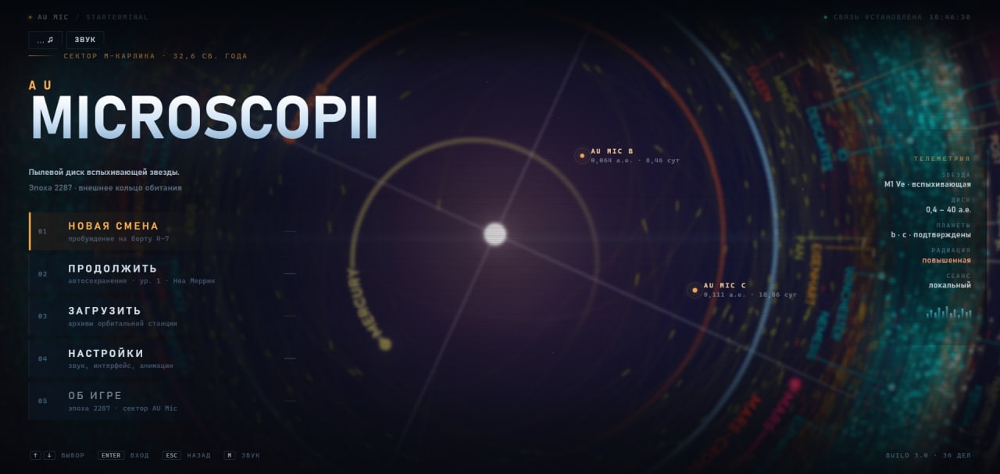

# AU MICROSCOPII · 2287

Браузерная НФ-RPG: станция R-7 на внешнем кольце пылевого диска AU Microscopii.
Интерфейс — в языке стартового экрана AU Mic (янтарь + бирюза, HUD-терминал,
срезанные панели, скан-линии). Версия 2.0 расширяет не оформление, а игру:
квестовые линейки, 25 дел, 18 финалов и понятный бой.

## Запуск

Открыть index.html двойным кликом — работает с file://, сборка не нужна.

    cd au-mic
    python -m http.server 8080    # http://localhost:8080

## Что нового в 2.0

**Квесты.** Было 7 коротких дел с тупиками; стало 25 дел в трёх линиях:

- основная линия — 11 дел, три акта: чипы → подпись → фракционные дела → перекличка;
- три личные линии по одному герою: дочь Ноа, архив Селин, тёмный груз Гарика;
- 11 фракционных дел: GrailTech, Руки Праха, Ковчег, Древние, Ложа, Фрактал, Vega.

У дела есть этапы, подсказки, требования, 2–3 пути решения, развилка с последствиями
(предмет, кредиты, опыт, репутация, вес нити) и следующий шаг. Провал проверки больше
не запирает дело: попытку можно повторить, а бой/взлом/убеждение дают обходной путь.
Закрытие дела может открыть новую комнату (админ-блок, серверная, B-12).

**Финалы.** 18 концовок (3 героя × 3 нити × 2 варианта) написаны текстом, а не
заглушками. Нить набирается завершёнными делами; поражение в бою помечает вариант.

**Журнал.** Активные дела с текущим этапом и подсказкой, завершённые с исходом,
проваленные, «где искать» (только реально доступные дела) и улики с названиями и
описаниями вместо сырых идентификаторов.

**Бой.** Сетка 6×6, d20 + навык против защиты, 2 AP. Добавлено:

- классы дистанции: ближний (1 кл.), короткий (2–3), дальний (4 кл.);
- штраф за дальний выстрел (−1 на 3–4 кл., −2 на 5+);
- укрытия: полуукрытие +2 к защите от выстрелов, полное +4 и блокирует линию огня;
  в упор укрытие не работает, pierce его игнорирует;
- свойства оружия: оглушение (−1 AP), кровотечение (1 урон ×2 хода), пробитие укрытия;
- броня даёт и защиту, и снижение урона (DR);
- у врагов есть дальность и точность, ИИ ищет укрытие и держит дистанцию;
- лог показывает бросок, защиту, укрытие, броню и урон;
- панель боя показывает карточку оружия, очередь ходов, дистанцию до целей,
  шанс попадания и причину, почему атака невозможна.

## Структура

    au-mic/
    ├─ index.html            каркас: сцена, фон, HUD, #app, оверлей панелей
    ├─ css/                  tokens, base, components, screens, title
    ├─ js/
    │  ├─ core.js            общий объект AU
    │  ├─ data.js            контент: 25 квестов, 18 диалогов, 32 улики, 18 финалов
    │  ├─ logic.js           правила: d20, инвентарь, торговля, бой, квестовый движок, сейвы
    │  ├─ ui.js              UI-кит
    │  ├─ screens-shell.js   титул, выбор героя, карта, локация
    │  ├─ screens-talk.js    диалоги, экран дела
    │  ├─ screens-char.js    рюкзак, уровень, журнал, торговля
    │  ├─ screens-fight.js   бой, эпилог
    │  └─ main.js            состояние, эффекты, пауза, настройки, самотест
    ├─ assets/               портреты, иконки, изо-тайлы, фоны, музыка, постер
    ├─ preview/              скриншоты экранов
    └─ QUESTS.md             карта всех 25 дел

## Как устроен квест

    q_mira: {
      title, line: 'main'|'personal'|'faction', act, hero,
      where, giver,
      requires: { all: [...], any: [...], minAny: 2 },
      unlock: ['admin'],
      stages: ['...', '...'],       // что нужно сделать
      hints: ['...', '...'],        // где искать
      branch: { A: '...', B: '...', C: '...' },
      branchInfo: { A: '...' },     // последствие для игрока
      branchReq: { B: { fact: 'f_log' } },
      rewards: { A: { item, xp, credits, rep, thread } },
      next: ['q_sign']
    }

Состояние дела: started, stage, done, branch, failed; stage — число закрытых
этапов. Развилка открывается только после последнего этапа; ветка может
требовать улику или предмет. Закрытие даёт вес нити A/B/C.

## Бой: формулы

- попадание: d20 + навык (Драка/Стрельба) + бонус перка − штраф дистанции
  против защиты + укрытие;
- защита: 10 + броня + (ТЕЛО − 5) / 2;
- урон: оружие + бонус перка − DR брони, минимум 1;
- шанс в панели — вероятность попадания без учёта крита/фамбла.

## Отладка

| Приём | Что делает |
|---|---|
| ?noveil=1 | без вступительной вуали |
| #selftest | прогон 40 автотестов (данные, все ветки 25 дел, UI, бой, сейвы) |
| #dev:hub | карта станции |
| #dev:loc | жилой сектор |
| #dev:dlg | диалог с Мирой |
| #dev:combat | бой с дронами |
| #dev:trade | торговля |
| #dev:inv | рюкзак |
| #dev:journal | журнал |
| #dev:levelup | повышение уровня |
| #dev:quest | дело «Руда X-34R» |
| #dev:pause | пауза |
| #dev:settings | настройки |
| #dev:heroes | выбор героя |
| #dev:end | эпилог |

Самотест: 40/40 OK, результат в window.__selftest.

## Проверки

- node --check для всех js;
- node tools/au-mic-probes/check_flow.js au-mic — каждый квест проходим через диалоги;
- node tools/au-mic-probes/playthrough.js au-mic — сквозное прохождение основной линии;
- Playwright-обход всех экранов и диалогов без ошибок консоли.

## Ограничения

- Бой остаётся d20 + AP + сетка 6×6; карточных дуэлей из раннего обсуждения здесь нет.
- Личные линии короткие (3 этапа), фракционные — 3 этапа: это каркас, а не финальный
  объём текста.
- Музыка и портреты — PNG/MP3 без сжатия; WebP по-прежнему в планах.
